# Instalación de ST-A/PI 01X_731 en BAS (lab)

18.11.2026

## Contexto

El 18.11.2026 se instaló ST-A/PI 01X_731 en el sistema de laboratorio BAS con SAINT, después de respaldar la base y los archivos. El import terminó bien a las 21:53, con advertencias RC 4.

| Dato | Valor |
| --- | --- |
| Sistema | BAS, mandante 000, servidor sapzrv |
| Producto | SAP ERP 6.0 EHP6 (SAP_BASIS 731, kernel 722) |
| Base de datos | Sybase ASE 15.7 sobre Windows 11 |
| SPAM/SAINT | 7.31/0043 |
| ST-PI instalado | 2008_1_700 SP0004 |
| Add-on a instalar | ST-A/PI 01X_731 (Servicetools for SAP Basis 731 and higher) |

Certificado de mantenimiento: el sistema no tiene uno válido. SPAM y SAINT muestran el aviso "Missing maintenance certificate" al entrar, pero en este sistema dejan seguir.

SPAM y SAINT se usan en idioma EN o DE: en español la barra de estado avisa "Llame a la transacción SPAM solo en inglés o alemán".

## Paso 1: backups

Los scripts están en la carpeta [`scripts`](scripts/).

Antes de tocar SAINT se respaldó la base de BAS, las bases de sistema de Sybase y los archivos que el import podría afectar. Todo quedó en `C:\backup-SYB`, con 50,9 GB libres en C: después.

El dump de Sybase se hace en caliente: SAP y la base quedan levantados. Para restaurar sí hay que bajar SAP.

### 1.1 Revisión previa en SAP

1. SPAM en el mandante 000: estado verde, sin cola definida y sin paquetes nuevos cargados.
2. SM37: el job `RDDIMPDP` está liberado en el 000 (también `RDDIMPDP_CLIENT_001`), con corridas anteriores terminadas sin error.
3. Historial de SPs: ST-PI 2008_1_700 en SP04 y los SPs de PI_BASIS, SAP_BW y SAP_AP figuran todos como importados.

SPAM antes de empezar: estado verde y sin cola.

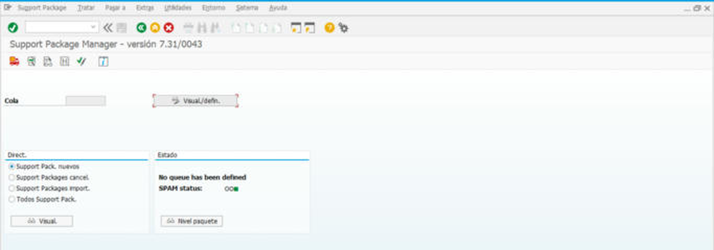

SM37 en el 000: `RDDIMPDP` liberado.

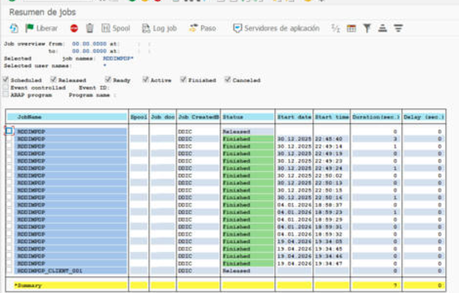

### 1.2 Dump de la base BAS

Script `dump_db_v3.bat`, con barra de progreso. Pide la contraseña de `sapsa` al correr y no la guarda.

```
cd /d C:\backup-SYB
dump_db_v3.bat BAS
```

Resultado:

```
[####################] 100%
Escrito: 48775 MB    Tiempo: 5 min 30 s
Dump: C:\backup-SYB\BAS_20261118_211256.dmp
OK: el log dice DUMP is complete.
```

### 1.3 Dump de saptools y master

Script `dump_saptools_master.bat BAS`: hace los dos dumps seguidos y controla que el log tenga dos "DUMP is complete". Dejó `saptools_BAS_20261118_212642.dmp` (12,8 MB) y `master_BAS_20261118_212642.dmp` (15,7 MB).

### 1.4 Copia de archivos

Script `copiar_archivos_sap_v2.bat BAS`. Copia a `C:\backup-SYB\archivos_BAS_20261118_212513`:

| Qué | Origen |
| --- | --- |
| Buffer de transporte | `\\sapzrv\sapmnt\trans\buffer\BAS` |
| Perfiles | `\\sapzrv\sapmnt\BAS\SYS\profile` |
| Configuración de ASE | `C:\sybase\BAS\BAS.cfg` |
| Interfaces de Sybase | `C:\sybase\BAS\ini\sql.ini` |

No se respalda el kernel (SAINT no lo toca) ni `EPS\in` y los logs de trans, que se pueden regenerar.

Contenido de `C:\backup-SYB` al terminar los backups:

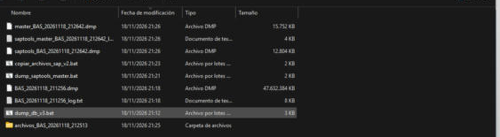

## Paso 2: paquetes en EPS\in

Los tres `.SAR` de ST-A/PI 731 (bajados a `C:\SAP UP\ST-API_731`) se descomprimieron en el inbox EPS, que SAINT lee como `\\sapzrv\sapmnt\trans\EPS\in` (en disco, `C:\usr\sap\trans\EPS\in`).

| Archivo | Tamaño | .PAT que contiene | Paquete OCS |
| --- | --- | --- | --- |
| KITABCA.SAR | 74 MB | I720020751259_0174470.PAT | SAPKITABCA |
| KITABCB.SAR | 58 MB | I710020751258_0178859.PAT | SAPKITABCB |
| KITABCC.SAR | 53 MB | I720020751259_0181855.PAT | SAPKITABCC |

Los `.SAR` ya traen la ruta `EPS\in` adentro. Al descomprimirlos dentro de `EPS\in`, los `.PAT` quedaron en `EPS\in\EPS\in` y SAINT no los encontró. Se movieron un nivel arriba y se limpió la carpeta:

```
cd /d C:\usr\sap\trans\EPS\in
move EPS\in\*.PAT .
rmdir EPS\in
rmdir EPS
del KITABCA.SAR KITABCB.SAR KITABCC.SAR sapcar.exe
```

Para la próxima vez: descomprimir parado en `C:\usr\sap\trans` (no en `EPS\in`), o desde cualquier carpeta con `sapcar -xvf <archivo>.SAR -R C:\usr\sap\trans`.

## Paso 3: SAINT

Los tres paquetes se cargaron sin error y SAINT ofrece un solo add-on: ST-A/PI 01X_731, de tipo Installation.

1. Entrar al mandante 000 con idioma EN.
2. `/nSAINT` y aceptar el aviso de certificado. Se ve la lista de add-ons instalados; la versión del título es 7.31/0043.
3. Menú Installation Package → Load packages → From Application Server.
4. Confirmar la carga desde `\\sapzrv\sapmnt\trans\EPS\in` con Yes.
5. El primer intento respondió "No OCS files were found for uploading", por la subcarpeta del paso 2.
6. Con los `.PAT` en su lugar, los tres paquetes figuran como "Uploaded successfully" (RC 0000).
7. Back y Start: la pantalla "Add-on selection" muestra ST-A/PI 01X_731, "Servicetools for SAP Basis 731 and higher".

Paso 2 de la lista: SAINT con los add-ons instalados.

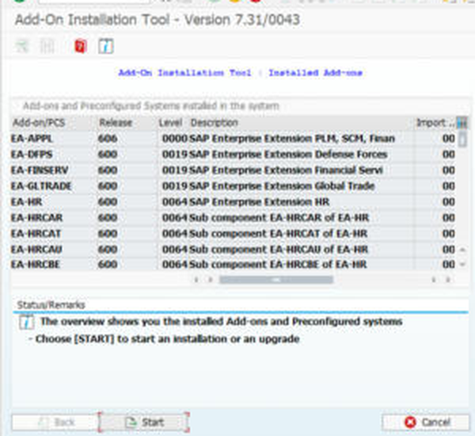

Paso 4: confirmación de la carga desde el inbox EPS.

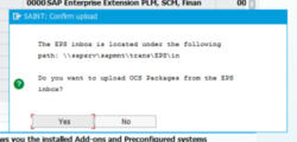

Paso 5: primer intento, con los .PAT en la subcarpeta.

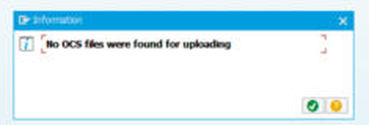

Paso 6: los tres paquetes cargados.

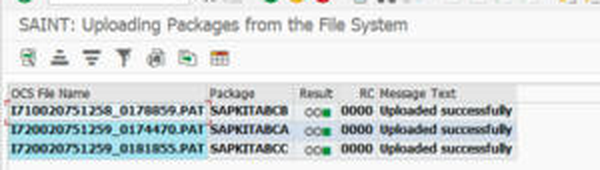

Paso 7: selección del add-on.

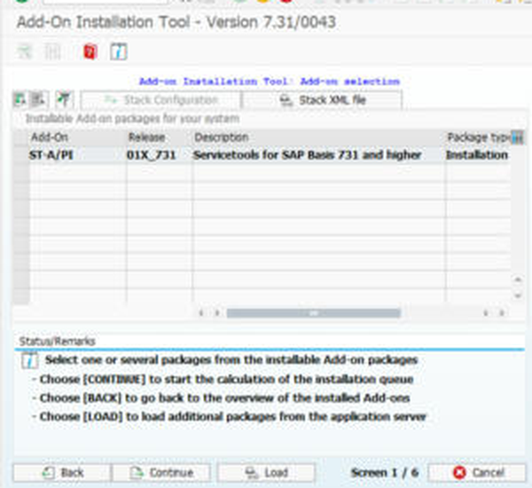

## Paso 4: cola e import

La cola quedó con un solo paquete, SAPKITABCA (Installation, ST-A/PI 01X_731), sin SPs adicionales ni transportes de ajuste. El import arrancó a las 21:47 en modo diálogo.

1. En "Add-on selection", marcar la fila ST-A/PI 01X_731 con el selector de la izquierda y Continue. Si la fila no queda marcada, SAINT avisa "Select a package from the installable Add-on packages".
2. Pantalla 2/6, Support Package selection: SAINT calcula SAPKITABCA nivel 0000. No se agregó ningún SP. Continue.
3. Pantalla 3/6, Calculated queue: solo SAPKITABCA. Continue.
4. "Add Modification Adjustment Transports to the queue?": No.
5. Important SAP Notes: SAPKITABCA pide leer la nota 69455 y no necesita contraseña. Aceptar.
6. Add-on installation: SAINT recomienda la nota 1597766 (problemas conocidos de SAINT en 7.31) y muestra las opciones de inicio: Preparation "Start in dialog" e Import 1, Import 2 y Clean Up "Continue in dialog". Aceptar con el tilde verde inicia el import.
7. El import pasa por las fases que muestra la barra de estado (DISASSEMBLE, Process object list, DD ACTIVATION, Execution of reports after put).
8. En la pantalla 6/6, Logs muestra el detalle por paso. Back y Finish confirman la cola.

Paso 2: Support Package selection, con SAPKITABCA calculado y sin SPs elegidos.

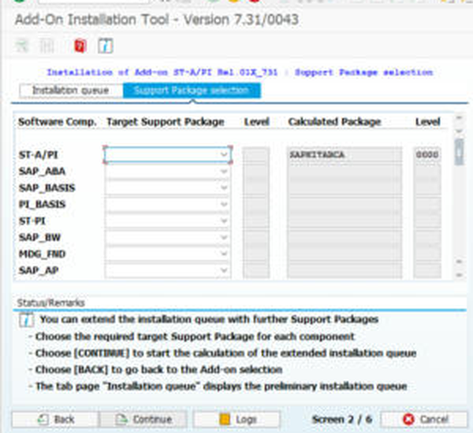

Paso 3: cola calculada, solo SAPKITABCA.

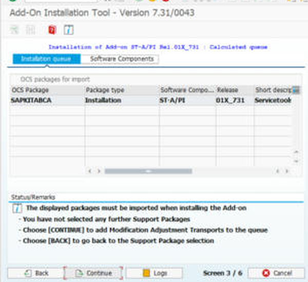

Paso 5: notas importantes, 69455 sin contraseña.

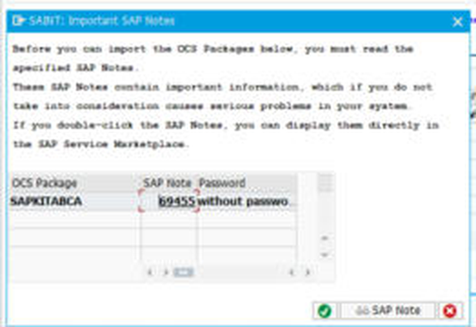

Paso 6: opciones de inicio, todo en diálogo.

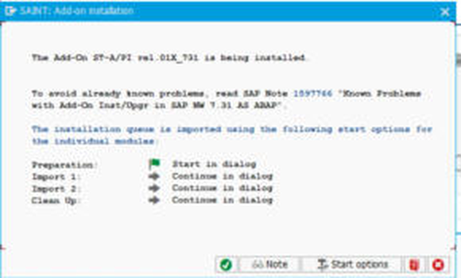

### Resultado

ST-A/PI 01X_731 quedó instalado: SAINT informó "The Add-on ST-A/PI rel.01X_731 was installed successfully" y "The add-on installation queue was confirmed". El import tardó unos 5 minutos, de 21:48:53 a 21:53:43, sin cortes.

| Paso del log | Hora | RC |
| --- | --- | --- |
| Generate Transport Information File | 21:48:53 | 0, Successfully Completed |
| Import Request Piece List | 21:48:56 | 4, Ended with Warning |
| Test Import | 21:49:01 | 4, Ended with Warning |
| Import ABAP Dictionary Objects | 21:50:31 | 4, Ended with Warning |
| ABAP Dictionary Activation | 21:51:12 | 4, Ended with Warning |
| Import | 21:52:07 | 4, Ended with Warning |
| Unknown Step | 21:53:43 | 4, Ended with Warning |
| Method Execution | 21:53:43 | 0, Successfully Completed |

RC 4 son advertencias y no frenan la instalación. La fase XPRA ("Execution of reports after put") corrió sin el error de `/SSF/SAO_UTILS` (KBA 2846060).

Logs del import de SAPKITABCA:

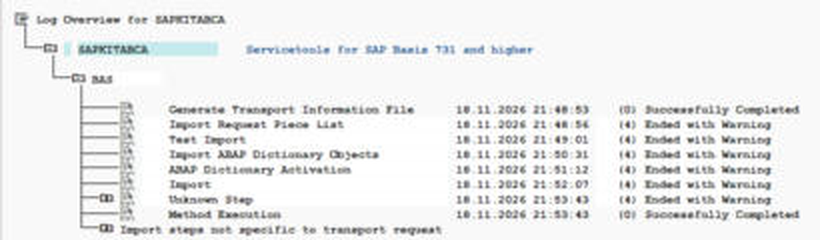

Después de Finish, SAINT confirma la instalación y la cola:

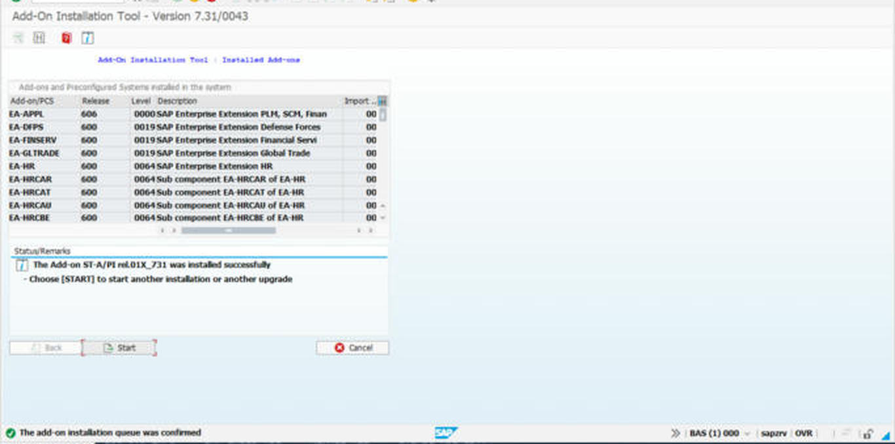

## Paso 5: verificación

ST-A/PI 01X_731 figura instalado en el sistema y SPAU no tiene nada de la instalación para ajustar.

1. SPAU (F8 con la selección por defecto): aparecen 2 BAdI de SAP (`UKM_BP1012_FICA_CHK`, `UKM_FSBP_BP3100`, en verde) y 2 Enhancement Spots de migración (`AUNITMIG1`, `ENHAUNITSPOTL1`). Son objetos estándar que ya estaban y no tienen que ver con ST-A/PI, que no dejó objetos `/SSA/` ni `/SSF/` para ajustar.
2. System → Status → Component information: ST-A/PI, release 01X_731, nivel 0000, "Servicetools for SAP Basis 731 and higher".

SPAU después de la instalación:

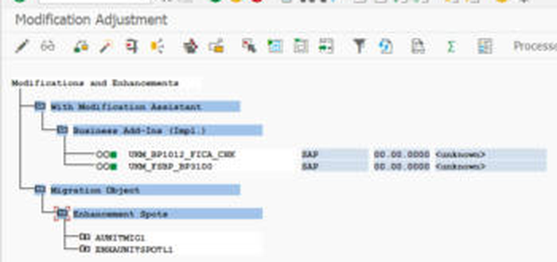

System → Status:

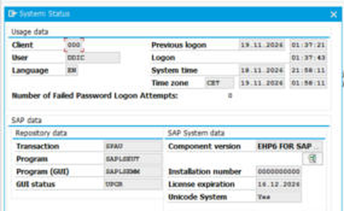

Component information con ST-A/PI 01X_731:

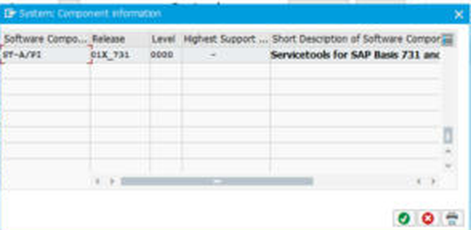

## Próximos pasos y vuelta atrás

Lo que queda después de la instalación:

- [ ] Revisar la nota 69455 para los pasos posteriores a la instalación
- [ ] Borrar los `.PAT` de `EPS\in` y las carpetas `archivos_BAS_...` incompletas de los primeros intentos

Si hay que volver atrás:

1. Bajar SAP (la instancia de Sybase queda arriba).
2. Restaurar desde isql:

```
load database BAS from 'C:\backup-SYB\BAS_20261118_211256.dmp'
go
online database BAS
go
```

3. Reponer `buffer_BAS` desde `archivos_BAS_20261118_212513` en `\\sapzrv\sapmnt\trans\buffer\BAS`.
4. Levantar SAP.

## Problemas encontrados

| Problema | Causa | Solución |
| --- | --- | --- |
| El primer dump dejó un archivo `BAS_~0,8DT:~8,6.dmp` de 0 bytes | Windows 11 ya no trae `wmic` y el timestamp quedó vacío | Timestamp con PowerShell (`Get-Date -Format yyyyMMdd_HHmmss`) desde `dump_db_v2.bat` |
| No se veía si el dump avanzaba | isql no muestra progreso | `dump_db_v3.bat`: corre el dump en fondo y muestra % y MB cada 5 s |
| No se encontró `BAS.cfg` | El script lo buscaba en `ASE-15_0`; en SAP está en `C:\sybase\BAS` | `copiar_archivos_sap_v2.bat` busca primero en la raíz |
| SAINT: "No OCS files were found for uploading" | Los `.PAT` quedaron en `EPS\in\EPS\in` | Moverlos a `EPS\in` (paso 2) |
| SPAM avisa que se use solo en inglés o alemán | Sesión en español | Entrar con idioma EN |
